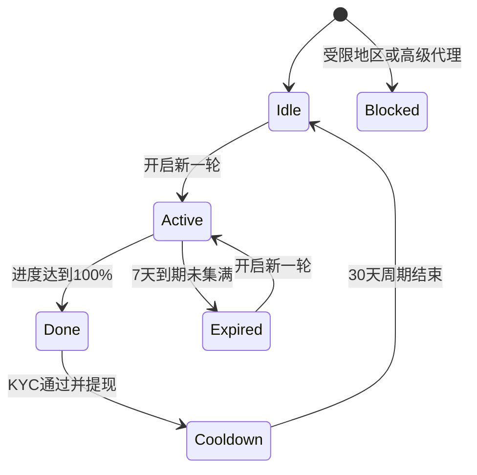

# 邀请助力（Invite Boost）产品需求文档

| 项目 | 内容 |
| --- | --- |
| 文档版本 | v1.1 |
| 更新日期 | 2026-10-13 |
| 产品形态 | App 内嵌 H5 活动页 |
| 原型地址 | `invite-boost/index.html`（本地预览：http://localhost:5178/invite-boost/index.html） |
| 参考竞品 | 币安「邀请返券」（凑进度提现 USDC） |
| 状态 | 待评审 |

---

## 1. 背景与目标

### 1.1 背景
现有的邀请奖励大多按注册发放，拉来的用户质量不稳定，薅羊毛成本低。币安「邀请返券」把奖励和受邀好友的入金、交易深度绑定，再加上「凑进度、限时提现」的玩法，推动邀请人持续拉人，并督促好友完成交易。

我们在 TW 产品上做一个同类活动：邀请人通过好友入金和交易来累积进度，集满后提现 USDT。

### 1.2 目标
- **业务目标**：带来有入金、有交易的新用户，而不是只注册的用户。
- **用户目标**：邀请人通过明确的任务和可见的进度拿到 USDT 奖励。
- **成本控制**：每位邀请人每 30 天最多拿 1 轮奖励（最高 50 USDT），没有集满的轮次不发奖励。

### 1.3 核心指标

| 类型 | 指标 |
| --- | --- |
| 北极星 | 活动带来的有效入金新用户数 |
| 过程 | 开启轮次人数、分享次数、邀请链接注册数、好友入金率、好友交易 1 手及以上的比例 |
| 结果 | 集满率、提现人数、单个有效新用户的获客成本（奖励成本 ÷ 有效新用户数） |
| 风控 | 被判定作弊的账户占比、撤销的奖励金额 |

---

## 2. 用户与场景

| 角色 | 说明 |
| --- | --- |
| 邀请人 | 已注册的 TW 用户，不在受限国家/地区，也不是高级代理 |
| 受邀好友 | 通过邀请链接或邀请码新注册的用户，不在受限国家/地区 |
| 不可参与 | 受限国家/地区用户；高级代理（用户代理、商务代理、IB 明星代理） |

**典型场景**：邀请人打开活动页，开启一轮后，平台先送 30% 进度加成。邀请人把链接分享到 WhatsApp、Telegram 等渠道，好友注册、入金、交易后，邀请人的进度上涨。7 天内集满 50 USDT，完成 KYC 后提现。

---

## 3. 活动规则

### 3.1 参与步骤
1. 点击「邀请好友」，获取专属邀请链接或邀请码。
2. 把邀请链接或邀请码分享给还没注册 App 的好友。
3. 受邀好友完成任务后，邀请人的奖励不断累积。
4. 继续邀请好友，积攒 USDT 并解锁提现权限。

> 注：每完成 1 个任务，进度提升 0.005%–10%，具体取决于用户的 App 活动历史。每位好友最多可助力 3 次（每个任务 1 次）。

### 3.2 平台任务

三个任务互相独立，不要求先入金再交易。人数、手数和入金门槛都不写死，由运营配置（见第 5 节）。

| 任务 | 内容 | 解锁规则（默认值） | 每位好友助力次数 |
| --- | --- | --- | --- |
| 任务 1 | 邀请新好友在平台完成入金 | 20 位好友入金达到 100%，每人加 5%。默认任意金额的首次入金都计入 | 1 |
| 任务 2 | 邀请新好友在平台交易 1 手 | 两条捷径取较高值，不叠加。累计：每位好友最多计入 1 手，累计 5 手达到 100%，每手加 20%。多人：5 位好友各自交易满 5 手时直接 100%，未打满前不加进度 | 1 |
| 任务 3 | 邀请 1 位好友在平台交易 5 手 | 单个好友达标直接 100%，未达标前不加进度 | 1 |

### 3.3 轮次与奖励
- 每 30 天最多完成 1 轮，每轮最高 50 USDT，每轮持续 7 天。
- 本轮没有集满的，到期后失效，不发放任何奖励。之后用户可以开启新一轮再试。
- 30 天内完成 1 轮后，要等下一周期才能开启新任务。
- 「我的进度」里的特殊加成由平台提供，用来帮用户更容易完成本轮，**不代表已收到奖励**。奖励只在本轮集满后发放。
- 解锁奖励后需完成 KYC 认证才能提现，每位用户每月仅可成功参与一次。失败轮次不占用这次名额。集满之后奖励保留，不随 7 天倒计时作废。

### 3.4 限制与风控
- 同一轮内，每位受邀好友完成必做任务后，最多为邀请人助力 3 次。
- 美分账户的交易量不计入有效交易量。
- 新用户只能选一种邀请方式注册，通过本活动链接注册的用户不能重复申请其他邀请奖励。
- 受限国家/地区的用户不能作为邀请人或受邀好友参加。
- 高级代理不参与本活动（用户代理、商务代理、IB 明星代理都不可参与）。
- 参与者涉嫌欺诈或恶意行为（例如用同一 IP 或设备注册多个账户），平台可以取消资格并撤销奖励。
- 平台保留调整活动机制的权利，包括奖励内容、任务要求和活动时间。最终解释权归平台所有。

---

## 4. 进度计算

### 4.1 公式
- **进度** = 平台特殊加成 + 任务 1 + 任务 2 + 任务 3，封顶 100%。
- **已累积金额** = 进度 × 奖励上限（50 USDT），显示 4 位小数。
- **还差金额** = 50 − 已累积金额。
- 活动历史只决定开局特殊加成，不改变单次助力比例。规则里的「0.005%–10%」只展示，不参与计算。
- 有加成时，轮次可以在名义人数或手数之前集满。任务卡仍显示真实计数，主卡以总进度为准。

| 任务 | 进度 |
| --- | --- |
| 入金 | 入金人数 ÷ `targetPeople` × 100% |
| 交易 · 累计 | 计入手数 ÷ `targetLots` × 100%。每位好友最多计入 `lotsPerFriend` 手 |
| 交易 · 多人 | 达标人数达到 `headcount` 时为 100%，未达标前为 0。达标条件是该好友累计交易满 `lotsEach` 手 |
| 交易合计 | 上面两条捷径取较高值，不叠加 |
| 大额交易 | 任意好友累计满 `lots` 手时为 100%，未达标前为 0 |

助力按发生时间先后计入，同一时刻先记累计手数，再记多人达标，最后记单人大额。超过 100% 的部分不计入。

### 4.2 示例（默认配置，普通活动历史，加成 30%）
- 开启一轮：平台加成 30%，即 15 USDT。
- 1 位好友入金：+5%，进度 35%，即 17.5 USDT。
- 8 位好友入金，其中 1 位交易 1 手：30% + 40% + 20% = 90%，即 45 USDT。同一好友再交易更多手，累计捷径不再增加，因为他已经计入 1 手。
- 任意 1 位好友交易满 5 手：任务 3 直接 100%，即 50 USDT。

### 4.3 已确认口径
进度按可配置目标计算：打满该任务目标 = 该任务 100%，单次助力 = 100% ÷ 目标。`0.005%–10%` 只写在规则里。活动历史只影响开局特殊加成。

默认数字下，任意好友先交易满 5 手会先触发任务 3，任务 2 的「5 人各满 5 手」不会单独走完。累计捷径也更容易先到：5 位好友各计入 1 手就已经是 100%。多人捷径要单独生效，需要把 `targetLots` 调到高于 `headcount × lotsPerFriend`，并把任务 3 的手数调到高于 `lotsEach`。

---

## 5. 运营配置项

所有参数由后台配置，前端读取后渲染。任务卡、进度计算和规则里的数字都跟着配置变化。

| 字段 | 含义 | 默认值 |
| --- | --- | --- |
| `currency` | 奖励币种 | USDT |
| `rewardCap` | 每轮奖励上限 | 50 |
| `roundDays` | 每轮持续天数 | 7 |
| `cycleDays` | 周期天数 | 30 |
| `roundsPerCycle` | 每周期最多轮数 | 1 |
| `maxBoostPerFriend` | 每位好友最多助力次数 | 3 |
| `bonusTiers` | 按活动历史分数选择开局加成。分数达到 `minScore` 就用该档，取满足条件的最高档 | 0 分 40%，30 分 30%，70 分 15% |
| `demoHistoryScore` | 原型用来选加成档的活动历史分数 | 45，对应普通档 30% |
| `specialBonusPct` | 当前用户开局时实际写入的平台特殊加成 | 由 `bonusTiers` 和活动历史算出，原型为 30% |
| `boostRange` | 规则中展示的单次提升区间，不参与计算 | 0.005%–10% |
| `tasks[deposit].targetPeople` | 入金任务达到 100% 需要的人数 | 20 |
| `tasks[deposit].minAmount` | 首次入金计入门槛。0 表示任意金额 | 0 |
| `tasks[trade].lotsPerFriend` | 累计捷径里，单个好友最多计入手数 | 1 |
| `tasks[trade].targetLots` | 累计捷径达到 100% 需要的计入手数 | 5 |
| `tasks[trade].headcount` | 多人捷径达到 100% 需要的人数 | 5 |
| `tasks[trade].lotsEach` | 多人捷径里，单个好友需要达到的手数 | 5 |
| `tasks[bigTrade].lots` | 大额交易任务的单人手数门槛 | 5 |
| `hashtag` | 海报话题标签 | #TWReferralBoost |

活动上下线时间仍由后台控制，本页不写死。

---

## 6. 用户状态与流程

### 6.1 状态说明

| 状态 | 进入条件 | 主卡展示 | 主按钮 |
| --- | --- | --- | --- |
| 未开启 | 当前周期未开启过轮次 | 每轮最高可得 50 USDT；开启后平台赠送 30% 进度 | 开启新一轮 |
| 进行中 | 轮次已开启，未到期、未集满 | 已累积金额、还差金额、进度条、剩余时间 | 邀请好友 |
| 快完成 | 同「进行中」，进度较高（交互相同，原型里单独列出方便演示） | 同上 | 邀请好友 |
| 已完成 | 进度 100% | 已集满 50 USDT；KYC 状态提示 | 立即提现 |
| 已过期 | 轮次到期未集满 | 金额置灰；「本轮已过期，未发放任何奖励」 | 开启新一轮 |
| 冷却中 | 本周期已提现 | 本周期奖励已提现；下一轮开启倒计时 | 等待下一周期（禁用） |
| 无资格 | 受限国家/地区或高级代理 | 暂不符合参与条件，并说明原因 | 暂不可参与（禁用） |

### 6.2 状态流转



### 6.3 提现流程

```mermaid
flowchart TD
    full[进度满100%] --> popup[弹窗: 恭喜本轮已集满]
    popup --> click[点击 立即提现]
    click --> kyc{已完成KYC?}
    kyc -->|否| kycDialog[弹窗: 需要完成KYC认证]
    kycDialog --> doKyc[跳转KYC认证]
    doKyc --> click
    kyc -->|是| confirm[弹窗: 确认提现50 USDT]
    confirm --> paid[发放至资金账户]
    paid --> cooldown[进入冷却期]
```

---

## 7. 页面需求

### 7.1 活动主页（从上到下）

| 模块 | 需求说明 |
| --- | --- |
| 导航栏 | 返回、标题「邀请助力」、规则入口「?」、分享入口 |
| 中奖播报条 | 吸顶，每 3 秒轮播一次「5*****4 获得了 50 USDT」。用户名脱敏，数据来自真实提现记录 |
| 进度主卡 | 已累积金额（大号黄色数字，4 位小数）；「还差 X USDT 即可提现」，未集满时点「提现」提示「集满 50 USDT 后才可提现」；进度条分两段颜色显示平台加成和好友助力，带图例。进度增加时金额有弹跳动效 |
| 轮次时间 | 进行中显示「本轮剩余 天/时/分/秒」，每秒刷新；其他状态显示对应文案 |
| 主按钮 | 黄色通栏按钮，文案随状态变化。滚出屏幕后，底部出现同款吸底按钮 |
| 状态说明 | 已过期、冷却中、无资格时，在主按钮下方显示原因 |
| 快捷入口 | 受邀用户（角标显示人数）、奖励、规则、进度，分别打开对应弹层 |
| 邀请人任务 | 标题和副标题「邀请好友，每 30 天最高可解锁 50 USDT」；3 张可横滑的任务卡，带指示点 |
| 任务卡 | 任务图标、完成状态、任务标题、标签（每位好友可助力 1 次 / 两条捷径取较高值 / 达标直接解锁 100%）、规则要点、当前进度和进度条、「邀请」按钮（只在进行中可点）。任务 2 有两条进度：累计计入手数，以及各满指定手数的人数。卡片只在该任务自己的目标打满时标成已完成 |
| 可获得的奖励 | 标题「最高 50 USDT 等您赢！」加「每 30 天」标签，3 条要点；右上角 i 图标弹出特殊加成说明 |
| 活动规则 | 底部文字链接，打开规则弹层 |

### 7.2 分享面板
- 上方是分享海报：文案「加入我！一起赚取奖励，最高达 50 USDT！」「立即注册，完成任务，赚取奖励。」`#TWReferralBoost`、插画、TW Logo、带邀请链接的二维码。
- 下方是底部弹层：邀请码和邀请链接，都可以一键复制；分享渠道横向滚动，依次是 WhatsApp、Telegram、X、Facebook、LINE、保存图片、复制链接。
- 非进行中状态点击邀请时不打开面板，改为提示「请先开启本轮」或「当前状态不可邀请」。

### 7.3 我的进度 / 我的邀请 / 我的奖励（三个标签页的底部弹层）

| 标签页 | 内容 |
| --- | --- |
| 我的进度 | 本轮时间段；待完成的助力任务数（所有好友剩余可助力次数之和）；提示「提醒好友完成任务…」；数据同步说明「认证和交易状态将在 1 小时内更新」；助力记录倒序排列，每条显示金额、来源（好友脱敏名 + 任务类型，或平台特殊加成）、记录时间。平台特殊加成那条注明「不代表已收到奖励」 |
| 我的邀请 | 好友列表：头像、脱敏名、注册时间、3 个任务完成标签、已助力次数（如 `2/3`）。没有好友时显示空状态和「邀请好友」按钮 |
| 我的奖励 | 顶部说明发放条件；已提现时显示奖励记录（金额、状态、发放时间），否则显示空状态 |

弹层底部固定一个「邀请好友」按钮。

### 7.4 规则弹层
展示第 3 节的完整规则，数字全部从配置读取。

### 7.5 弹窗

| 弹窗 | 触发时机 | 按钮 |
| --- | --- | --- |
| 本轮已集满 | 进度刚达到 100% | 去提现 |
| 需要完成 KYC | 未完成 KYC 时点击提现 | 稍后 / 去认证 |
| 确认提现 | 已完成 KYC 时点击提现 | 取消 / 确认提现 |
| 奖励说明 | 点击奖励卡片的 i 图标 | 好的 |

### 7.6 轻提示（toast）
复制成功、分享渠道已打开、海报已保存、新一轮已开启（附加成比例）、KYC 已通过、奖励已发放、提现未解锁、请先开启本轮。

---

## 8. 多语言与视觉
- 支持中文和英文，所有文案走多语言配置，数字从活动配置插值。
- 视觉采用黄黑配色：品牌黄 `#FCD535` / `#F0B90B`，背景 `#0B0E11`，卡片 `#181A20` / `#1E2329`，上涨绿 `#2EBD85`，警示红 `#F6465D`。
- 适配 375 宽的移动端视口，支持刘海屏安全区。

---

## 9. 数据与接口（建议）

| 接口 | 用途 | 关键字段 |
| --- | --- | --- |
| 获取活动配置 | 页面初始化 | 第 5 节的全部配置项 |
| 获取用户活动状态 | 主卡、按钮、倒计时 | 用户状态、是否有资格及原因、轮次开始/结束时间、周期开始时间、平台加成、当前进度、已累积金额、KYC 状态 |
| 开启新一轮 | 未开启或已过期时 | 返回新轮次信息 |
| 获取任务进度 | 任务卡 | 各任务当前值和目标值 |
| 获取助力记录 | 我的进度 | 来源好友、任务类型、助力比例、金额、时间 |
| 获取受邀好友列表 | 我的邀请 | 脱敏名、注册时间、各任务完成情况、已助力次数 |
| 获取奖励记录 | 我的奖励 | 金额、状态、发放时间 |
| 提现 | 已完成时 | 校验 KYC 和风控后发放至资金账户 |
| 获取邀请码和链接 | 分享面板 | 邀请码、链接、海报二维码 |
| 中奖播报 | 播报条 | 脱敏用户名、金额 |

**后端规则要点**
- 进度计算、封顶和助力次数上限都以后端为准，前端只负责展示。
- 交易量需要排除美分账户，交易手数按已平仓的标准手统计。累计捷径里每位好友最多计入配置的手数；多人捷径和单人大额只在达标时记 100%。
- 状态同步可以有最多 1 小时的延迟，页面上已注明。
- 轮次到期、周期结束由后端定时任务推动状态变化。

---

## 10. 埋点

| 事件 | 触发 | 参数 |
| --- | --- | --- |
| `invite_page_view` | 进入活动页 | 用户状态、进度 |
| `invite_round_start` | 点击开启新一轮 | 是否是过期后重开 |
| `invite_click` | 点击邀请按钮 | 入口（主按钮 / 吸底按钮 / 任务卡 / 弹层） |
| `invite_share` | 点击分享渠道或复制 | 渠道 |
| `invite_tab_view` | 查看三个标签页 | 标签页名称 |
| `invite_rules_view` | 打开规则 | 入口 |
| `invite_withdraw_click` | 点击提现 | KYC 状态 |
| `invite_kyc_go` | 点击去认证 | — |
| `invite_withdraw_success` | 提现成功 | 金额、轮次用时 |

---

## 11. 待确认事项

| # | 问题 | 当前处理 | 负责方 |
| --- | --- | --- | --- |
| 1 | 单次助力按固定比例，还是按「0.005%–10% 且取决于活动历史」 | 已确认：按可配置目标计算。活动历史只影响开局加成，0.005%–10% 只写在规则里 | 已关闭 |
| 2 | 平台特殊加成比例是否固定 30%，是否按用户分层 | 默认 30%，可配置 | 运营 |
| 3 | 交易任务的「1 手」按单笔还是累计、按开仓还是平仓统计 | 原型按累计手数 | 交易、数据 |
| 4 | 入金任务是否有最低金额门槛 | 未设门槛 | 运营 |
| 5 | 奖励发放形式：直接发 USDT，还是像竞品一样发代币券并设有效期 | 直接发放至资金账户 | 运营、财务 |
| 6 | 集满后是否有提现截止时间 | 未设截止 | 运营 |
| 7 | 规则第 1 条写「每个交易任务 1 次」，但入金也算助力，是否改成「每个任务 1 次」 | 按每个任务 1 次处理 | 运营、法务 |
| 8 | 正式 Logo、分享渠道图标、海报插画 | 目前为占位 | 设计 |

---

## 12. 验收标准
- 7 个状态的主卡、倒计时、按钮、说明文案和第 6 节一致。
- 修改配置里的人数和手数后，任务卡、进度计算和规则文案同步变化。
- 进度封顶 100%，每位好友助力不超过 3 次，超出部分不计入。
- 未集满时不能提现；未完成 KYC 时提现前先引导认证。
- 提现后进入冷却期，倒计时正确，周期内不能再开启新一轮。
- 已过期的轮次不发奖励，可以重新开启。
- 受限地区用户和高级代理看到无资格状态，所有邀请入口不可用。
- 复制邀请码和链接成功，分享渠道都能调起。
- 中英文切换后，全部文案正确。
